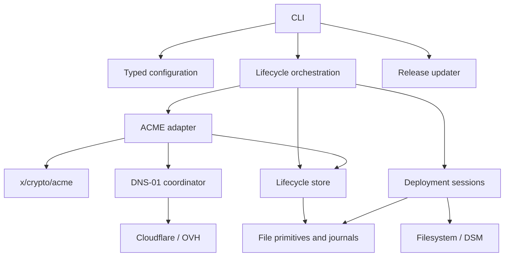

# Architecture

XCertM has one Go module, `github.com/kernaxis/xcertm`, and one binary, `xcertm`.
Dependencies are passed explicitly; configuration is not globally mutable.
There is no database, daemon, plugin loader, DI framework, or empty future package.

## Components and dependency direction

| Package | Responsibility and dependencies |
| --- | --- |
| `cmd/xcertm` | Process entry point, injectable version, exit code; calls `cli`. |
| `internal/cli` | Flags, request assembly, presentation; uses typed `config` and `app`, never performs ACME/DNS/deployment operations itself. |
| `internal/update` | Public release discovery, checksum verification, retained license notices, installation locking and executable replacement; standard library only, without certificate configuration or store dependencies. Called directly by `cli`. |
| `internal/config` | Strict optional YAML, typed inputs, path resolution, validation, secret references, resolver selection; uses domain name validation. |
| `internal/domain` | Immutable generations, certificate/key/chain coherence, exact DNS SAN comparison; standard library only. |
| `internal/app` | Renewal policy, lifecycle orchestration, independent destinations, public inspection; explicitly assembles ACME/DNS/deployment adapters and store. |
| `internal/acme` | Recoverable orders and accounts using `golang.org/x/crypto/acme`; consumes `config`, `domain`, `dns` coordination, and `store`. No deployment dependency. |
| `internal/dns` | Publication intents, targeted cleanup, bounded TXT propagation; narrow provider/resolver contracts with real consumers. |
| `internal/dns/cloudflare`, `internal/dns/ovh` | Provider HTTP protocols, record identities and drift checks; shared DNS capabilities and standard library only. |
| `internal/deploy` | Sessions, target contract, PEM rendering; uses `domain` and `state`, without ACME or DNS dependencies. |
| `internal/deploy/filesystem`, `internal/deploy/dsm` | Concrete local plans, metadata checks, DSM activation; use deployment/state/domain capabilities. |
| `internal/store` | Versioned accounts, generations, issuance progress, deployment requests and inventory; uses typed requests/domain/DNS publication data and `state`. No CLI, network, or concrete adapter dependencies. |
| `internal/state` | Atomic file writes, synchronization, locks, snapshots and journal replay; semantic validation and activation use callbacks, with no concrete adapter dependency. |

The application supplies concrete providers to the DNS coordinator. Interfaces
exist for provider operations, propagation resolution, and deployment targets;
there is no interface per package. The ACME protocol is not reimplemented.
Only DSM uses optional target initialization to register a dedicated entry under
the shared locks before read-only planning; its ID and index recovery remain
inside the adapter. File publication/replay stays in the common coordinator.
`x/crypto/acme` supplies RFC 8555, JWS, nonces, orders and certificate retrieval;
XCertM adds lifecycle persistence, policy and recovery. Its BSD license is
compatible with MIT distribution, with the required notice retained.

## Business invariants

- A managed certificate has a stable logical ID and multiple obtained generations.
  Requested configuration, obtained resources, and operational progress are distinct.
- A generation is immutable after validation: leaf, issuer chain and private key
  remain coherent. Each new issuance uses a fresh ECDSA P-256 certificate key,
  separate from the persisted ACME account key.
- Provenance is explicit (`acme` plus order URL for issuance), without requiring
  all possible sources to be ACME. Imports remain outside the MVP.
- Destination IDs are stable and distinct from their type/location. A destination
  belongs to one managed certificate in a store. Interrupted deployments retain
  their original generation and target parameters despite new configuration.
- One generation can reach several destinations with different results. No
  transaction spans destinations, and deployment failure never automatically
  triggers another issuance.
- Generation storage precedes cleanup and deployment. An interrupted operation
  is identified and reconciled; a failed HTTP response does not prove no effect.
- Keys, generations, failed issuance records, and deployment stages are retained.
  No garbage collection removes material still needed for recovery.

## Validation and trust

`domain.NewGeneration` copies and validates DER certificate/chain and PKCS#8 key
material at an explicit UTC time. Accessors return copies. It rejects mismatched
keys, invalid signatures/ordering/constraints, duplicate issuers, a CA leaf, and
material invalid at that instant. The last supplied issuer is a local coherence
anchor; an empty chain is accepted by the domain API. This does not establish
public trust, revocation status, or future validity. CA endpoint authentication
uses normal HTTPS verification; no insecure TLS option is exposed.

Issuance separately checks exact requested DNS SAN equality. ASCII case, a final
root dot and duplicate names are normalized; wildcard SANs remain literal,
distinct identifiers. Names must be ASCII hostnames (IDNs already in A-label
form), not IP literals. There is no CN fallback or Unicode conversion.

## DNS-01 and wildcard behavior

Standard and wildcard names can coexist, including `example.com` and
`*.example.com`. All required TXT values are published before accepting any
challenge; matching values at one owner coexist. Cleanup checks the saved record
identity and exact value, preserving unrelated and previously existing records.

Publication intent is persisted before creation, followed by the returned ID.
After a lost response, one exact matching record can be reconciled with that
intent; multiple matches require manual intervention. This assumes no other
writer creates the identical challenge value during that interval. There is no
distributed exactly-once guarantee across the provider API and local disk.
OVH zone refresh follows durable record identification and is repeated on retry.

Propagation polls the selected recursive resolver(s) with a deadline. This proves
visibility there, not at every authoritative server or at the CA. CNAME delegation
and automatic challenge-zone redirection are not implemented. A configured zone
must contain the actual challenge owner. Provider API errors omit response bodies
and credential headers. HTTP 429 retry delays are retained in pending issuance.

## Recovery and storage

The lifecycle store uses private versioned JSON files, independently of user YAML.
A per-store lock serializes lifecycle writers. Account identity includes directory
URL and email; generation requests record production/staging independently.
Read-only inspection creates no locks/directories and reports recorded observations,
not the current certificate served by an application.

Pending issuance retains the key, CSR, order URL, publication intents/identities,
and retry deadline. Repeating the same request resumes that order. Once a
generation is saved, cleanup retries reuse it without another ACME request.
If the *new-order* response is lost before its URL is saved, retry may create an
additional unfinalized order; it does not deliberately finalize two certificates.
Terminal failed orders are archived after safe DNS cleanup.

Local deployment uses per-destination journals and resource locks. Atomic rename
applies to one file at a time, so readers can observe a mixed set during updates.
Recovery advances toward the recorded generation, checks external drift, and
does not roll back automatically. See [deployment details](deployment.md).

## Scope and verification

Implemented commands are `issue`, `renew`, `deploy`, `list`, `show`, `update`, help and version.
Optional YAML/flags, Let's Encrypt, Cloudflare, OVH, and both local deployment
targets are wired together. Tests exercise HTTP/JWS issuance with the real ACME
library, signed provider requests, wildcard coexistence, key rotation, loss of
responses, retained generations, partial deployment, replay, and read-only CLI.

Automated tests use local services and simulated DSM layouts; they do not prove
compatibility with every NAS or live provider configuration. Installer/updater
tests use local release servers and temporary installation prefixes. See
[installation and updates](../installation.md) for the distribution trust model.
Remote deployment, import, account migration,
revocation, automatic cleanup/GC, CNAME challenge delegation, and Linux service
management are outside this MVP. Dependency and license details are in
[third-party notices](../../THIRD_PARTY_NOTICES.md).
